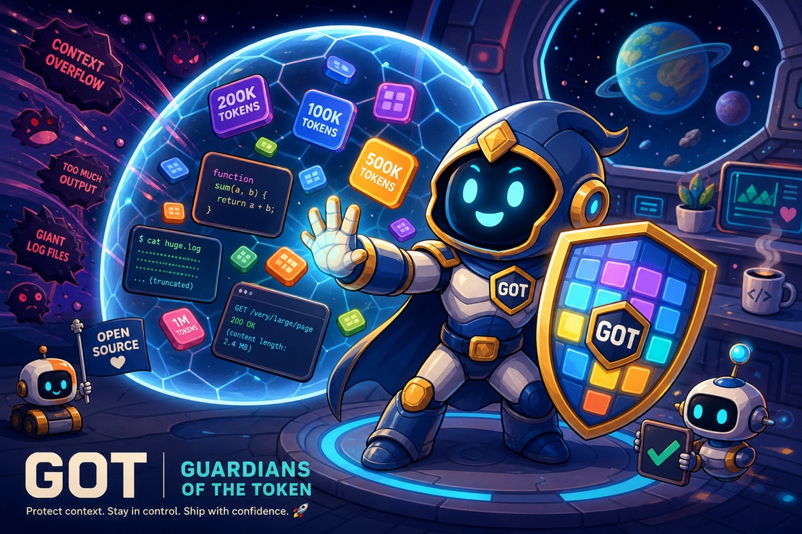
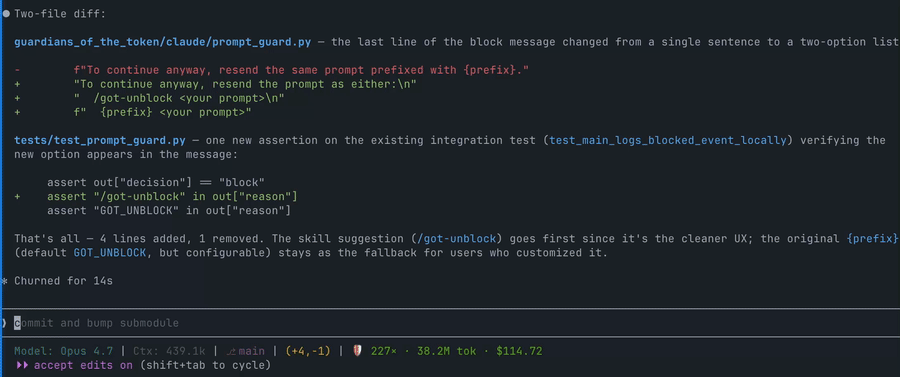

# GOT

[](https://pypi.org/project/guardians-of-the-token/)
[](https://pypistats.org/packages/guardians-of-the-token)
[](https://pypi.org/project/guardians-of-the-token/)
[](LICENSE)
[](https://github.com/tonylee2016/guardians_of_the_token/stargazers)
[](https://github.com/tonylee2016/guardians_of_the_token/actions/workflows/ci.yml)



**Guardians of the Token** keeps agentic coding sessions from wasting context.
It runs locally and watches the moves that quietly blow up your context window —
reading a huge file, fetching a big page, dumping noisy command output, or
drifting off-topic in a long session — and pauses them before they cost you.



## Why GOT

One bad move can burn your whole context window:

- reading a giant log or transcript into chat
- dumping command output that should have gone to a file
- fetching a large page directly into the model
- sending an off-topic prompt into an already-huge session

GOT turns those into a clear pause instead of a silent loss:

```text
🛡️ Guardians of the Token blocked this command.
Target: /tmp/big.log
Estimate: ~200,000 tokens (50% of the 400,000-token window)
Next options (reply with a number):
1. Inspect the beginning
2. Inspect the end
3. Search for a term
4. Summarize a bounded section
5. Bypass once for the full file
```

Reply with a number and Claude carries out that option.

Guarding runs locally with lightweight token estimates. Your files, prompts,
and commands never leave your machine (see
[What GOT runs and sends](#what-got-runs-and-sends)).

## Install

One install for every client:

```bash
pipx install guardians-of-the-token   # or: pip install guardians-of-the-token
guardians-install
```

`guardians-install` finds your clients and sets each one up the best way it
can. Pick from the checkbox list, or add `--yes` to take everything detected
(telemetry stays off unless you tick it):

| Client | What `guardians-install` sets up |
| --- | --- |
| Claude Code: CLI, VS Code, JetBrains, the Claude app's Code tab | The Claude Code plugin, via the `claude` CLI: hooks, MCP size tools, and `/got-*` skills. Without the `claude` CLI on your `PATH`, it writes the hooks into `~/.claude/settings.json` instead. |
| Codex CLI | Hooks in `~/.codex/hooks.json` |
| Codex app | MCP size tools in `~/.codex/config.toml` |
| Claude app chat (Claude Desktop) | MCP size tools in `claude_desktop_config.json` |

Every hook and MCP entry runs GOT with the full path of the Python it was
installed into, so pipx and virtualenv installs work. Running `guardians-install`
again is safe: it refreshes GOT's own entries, leaves yours alone, and when it
switches Claude Code to the plugin it removes GOT's older `settings.json` hooks
and `/got-*` skill copies so nothing runs twice. Restart Claude Code afterwards.

That's it — the guards are now active. The rest of this README is what they do
and how to tune them.

### Install the Claude Code plugin by hand

If you only use Claude Code, you can skip the Python step and run this in
Claude Code instead:

```text
/plugin marketplace add tonylee2016/guardians_of_the_token
/plugin install guardians-of-the-token@guardians-of-the-token
```

The plugin bundles the hooks, MCP server, and skills. It needs Python 3.10+ as
`python3`. If the `guardians-of-the-token` package isn't already installed, the
first session shows a notice and installs it in the background into a private
venv at `~/.guardians/plugin-venv`, pinned to the plugin's version. It never
touches your system Python. The guards switch on by themselves when the install
finishes, usually within a minute. If it fails, the next session tells you and
points to `~/.guardians/plugin-install.log`.

Plugin skills are namespaced under the plugin name:

- `/guardians-of-the-token:got-unblock <prompt>` — bypass the prompt guard for
  one prompt.
- `/guardians-of-the-token:got-resume` — resume from the saved project-state
  snapshot.
- `/guardians-of-the-token:got-pause <duration>` — pause all guards for a while.

## What you get

| Client | What GOT guards |
| --- | --- |
| Claude Code | `Read`, `Bash`, `WebFetch`, oversized output, off-topic prompts, and cold-start continuity |
| Codex CLI | risky `Bash` file dumps, URL fetches, oversized output |
| Codex app, Claude app chat | MCP size tools: size a file or URL, then read the head, tail, a search, or a summary |

### 1. Context guard

Before a risky `Read`, `Bash`, or `WebFetch` runs, GOT estimates its token cost
from file size, URL metadata, or command shape. If it's too large it blocks the
call and suggests bounded alternatives (inspect, search, summarize). Oversized
command output is trimmed before it reaches the model.

Need the full payload anyway? Reply with the "Bypass once" option and Claude
retries it once. You can also do it yourself:

```bash
touch /tmp/guardians_bypass
```

### 2. Prompt guard (Claude Code)

Once a session passes ~30% of the context window, GOT checks each new prompt for
topic drift. If a prompt looks unrelated to what you've been doing, it's blocked
*before* Claude reads it — saving a full round-trip of input tokens.

```text
🛡️ Guardians blocked this prompt before Claude processed it.

Reason: this looks unrelated to the current large Claude session.
Similarity: 0.07 (block threshold 0.10)
Context: 412.6k / 1.0M tokens (41%)
Estimated cost if sent: $1.2378

To continue anyway, resend the prompt prefixed with GOT_UNBLOCK.
```

To send it anyway, resend prefixed with `GOT_UNBLOCK` (or run `/got-unblock`).
A small ONNX model (~22 MB) is fetched automatically on install; re-fetch it
anytime with `guardians-download-models`.

### 3. Cold-start resume (Claude Code)

Long sessions eventually compact, and the next session starts cold. As a session
approaches its limit, GOT saves a snapshot of what you were doing to
`.got/project_state.md` — the latest summary, your recent goals, files touched,
and recent commands — built entirely from the local transcript.

On your next cold start in that project, GOT tells you a snapshot exists and asks
if you want to resume. To load it:

```text
/got-resume
```

Claude reads the snapshot and picks up where you left off. Nothing is injected
unless you ask.

## Pause the guards

About to do something the guards would flag — read a big file, paste a large
log, run a noisy command — and don't want to be interrupted each time? Pause
every guard (Claude, Codex, any CLI) for a while:

```bash
guardians pause 1h     # pause for an hour
guardians resume       # re-enable now
```

Durations accept seconds, minutes, hours, and days, plus combinations — `45s`,
`30m`, `1h`, `1h30m`, `2d`. A bare number means minutes (`guardians pause 90`).
In Claude Code you can do the same with `/got-pause 1h` (and `/got-pause off`).

The pause is global and auto-expires (capped at 7 days), so a forgotten pause
re-enables itself. While it's active every guard exits silently — no context
blocks, no prompt guard, no output trimming, no snapshots.

## Configuration

User config lives at `~/.guardians.json`; per-project overrides go in
`.guardians.toml`. Common knobs:

```json
{
  "warn_threshold_pct": 20,
  "max_output_tokens": 8000,
  "telemetry_enabled": false,
  "prompt_guard": {
    "enabled": true,
    "block_context_pct": 0.30,
    "very_low_similarity": 0.10,
    "unblock_prefix": "GOT_UNBLOCK"
  },
  "project_state": {
    "enabled": true,
    "save_context_pct": 0.70,
    "max_age_hours": 168
  }
}
```

Thresholds are percentages of the model's context window, which GOT reads from
the session transcript: current Claude models (Opus 4.6+, Sonnet 4.6+, the 5.x
family, Haiku 5.5, Fable) count as 1M tokens; older ones such as Haiku 4.5,
Sonnet/Opus 4.5 and earlier, and Claude 3.x count as 200K. On an unusual setup
(a proxy, a custom model id, a smaller deployment) pin it yourself:

```json
{ "context_window": 200000 }
```

Set any feature's `"enabled": false` to turn it off. In `.guardians.toml` you can
also whitelist known-safe paths so agents never get blocked on them:

```toml
whitelist = ["README.md", "docs/**"]
ignore = ["node_modules/**", ".git/**"]
```

## Reports

GOT logs every block, trim, and snapshot locally to `.got/events.jsonl`.

```bash
guardians-report      # text summary of tokens and dollars saved
guardians-dashboard   # local web dashboard at 127.0.0.1:8766
```

Telemetry is **off by default**. If you opt in, GOT sends a single anonymous
install event (install ID, version, Python version, OS) — never paths, prompts,
content, commands, or token counts. Toggle with `GUARDIANS_TELEMETRY=0|1`.

Keep GOT current:

```bash
guardians update          # update from PyPI
guardians update --check  # check only
```

## What GOT runs and sends

Everything below is local unless it names a host.

- **Hooks** (Claude Code plugin or `guardians-install`): Python scripts that run
  before `Read`, `Bash`, and `WebFetch`, after `WebFetch`/`WebSearch`, on each
  prompt, on session start, and before compaction. They read the session
  transcript and file sizes on your machine, and write events to
  `.got/events.jsonl` and snapshots to `.got/project_state.*` in your project.
- **WebFetch guard**: sends a `HEAD` request to the URL Claude was about to
  fetch, to read its size. No other data is sent.
- **Plugin install** (plugin only): on first run, downloads
  `guardians-of-the-token` and its dependencies from PyPI (`pypi.org`) into
  `~/.guardians/plugin-venv`.
- **Prompt-guard model**: downloads a ~22 MB embedding model
  (`Xenova/all-MiniLM-L6-v2`) from Hugging Face (`huggingface.co`) once, during
  install, and runs it locally.
- **Updates**: off by default. `guardians update` checks `pypi.org` when you
  run it. If you set `"auto_update_enabled": true`, the session-start hook
  checks `pypi.org` at most once a day and upgrades within the same major
  version.
- **Telemetry**: off by default. If you opt in, it sends one anonymous install
  event (install ID, version, Python version, OS) to PostHog
  (`us.i.posthog.com`). It never sends paths, prompts, content, commands, or
  token counts.
- **MCP server** (`guardians-mcp`): local stdio server, no network listener.

## Advanced

These surfaces are optional and aimed at non-hook workflows:

- **`guardians-mcp`** — MCP server giving Claude Desktop projects bounded file
  tools (`got_file_size`, `got_file_head`, `got_file_search`, …) and a preflight
  policy. Initialize a project with `guardians-project-init /path/to/project`.
- **`guardians-proxy`** — minimal FastAPI proxy that estimates request size for
  Anthropic/OpenAI-style payloads before forwarding (experimental).
- **`guardians-test-server`** — local fixture server for testing URL guards
  without downloading large payloads.

Manual / scoped installs are also available, e.g.
`guardians-claude-install /path/to/workspace` or `--global`, and the same for
`guardians-codex-install`.

---

GOT is early, practical infrastructure for local LLM workflows, focused on
preventing accidental context loss in Claude Code and Codex.
